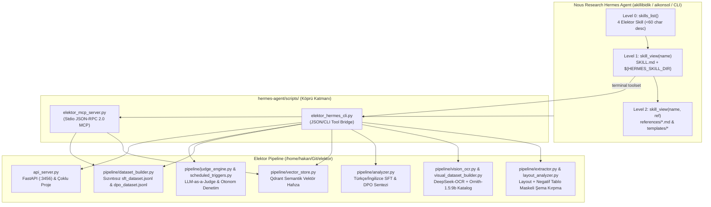

# Mimari Rehber: Hermes Agent & Elektor Veri Seti Pipeline (`ARCHITECTURE.md`)

Bu belge, **Nous Research Hermes Agent** mimarisinin (Progressive Disclosure Skills, Toolsets, Subagent Delegation, Cron Blueprints ve MCP) **Elektor Veri Seti Pipeline** bileşenleriyle nasıl eşleştiğini açıklar.

---

## 1. Uçtan Uca Mimari Akış Diyagramı

---

## 2. Hermes Progressive Disclosure Tasarımı

Hermes Agent'ın bağlam penceresini (context window) verimli kullanmak için yetenekler 3 katmanlı olarak tasarlanmıştır:

1. **Level 0 (Sistem İsteminde Sürekli Yüklü — ~30 token/skill)**:
   - Yalnızca `name`, `category: data` ve `<= 60` karakterlik tek cümlelik `description` alanı sistem isteminde yer alır.
2. **Level 1 (`skill_view(name)` — ~110 satır)**:
   - Ajan ilgili görevi üstlendiğinde `SKILL.md` gövdesini yükler. İçerisinde `${HERMES_SKILL_DIR}/scripts/elektor_hermes_cli.py` çağrıları, kontrol kriterleri (`Completion criterion`) ve tuzaklar (`Pitfalls`) yer alır.
3. **Level 2 (`skill_view(name, "references/...")` — İhtiyaç Anında)**:
   - Derin şema ayrıntıları (`sft-dpo-schemas.md`, `layout-and-cropping.md`, `qdrant-and-sqlite.md`, `cli-and-api.md`) yalnızca ajan ihtiyaç duyduğunda okunur.

---

## 3. Ev Sahibi Sözleşmelerine (Host Contracts) Bağlanma

`elektor_hermes_cli.py` ve `elektor_mcp_server.py`, Elektor'un üretim sözleşmelerine birebir bağlıdır:
- **Düz `config.json` Şeması**: `project_id`, `db_path`, `qdrant_db_path`, `qdrant_collection_name`, `ollama_url`, `model_vision` (`deepseek-ocr:3b-bf16`), `model_analyzer` (`ornith-1.5:9b`), `model_embedding` (`nomic-embed-text:latest`).
- **Hermes Yapılandırma Çözümleme**: Ortam değişkenlerinin (`ELEKTOR_REPO_PATH`, `ELEKTOR_API_URL`) yanı sıra `~/.hermes/config.yaml` altındaki `elektor.repo_path` ve `elektor.api_url` değerlerini otomatik okur.
- **FastAPI Çoklu Proje Sözleşmesi**: `/api/projects/select` için `{"project_id": "..."}` ve `/api/projects/create` için `{"project_id": "...", "project_name": "..."}` gövdelerini gönderir.
- **Gerçek İhraç Artefaktları (`exports/<project_id>/`)**: `sft_dataset.jsonl`, `tr_sft_dataset.jsonl`, `dpo_dataset.jsonl`, `tr_dpo_dataset.jsonl`, `chat_dataset.jsonl`, `tr_chat_dataset.jsonl`, `multimodal_visual_dataset.jsonl`, `multimodal_catalog.md` ve `cloud_payload/unsloth_colab_<type>_<project_id>.ipynb`.

---

## 4. Hermes Araç Setlerinin (Toolsets) Elektor Bileşenleriyle Eşleşmesi

| Hermes Agent Aracı | Kullanıldığı Skill | Elektor Karşılığı ve Davranışı |
| :--- | :--- | :--- |
| `terminal(command=...)` | Tüm 4 Skill | `${HERMES_SKILL_DIR}/scripts/elektor_hermes_cli.py` üzerinden sağlık kontrolü, aşama yürütme (`run-stage`), Qdrant/SQLite arama ve kırpma denetimi yapar. |
| `skill_view(name, path)` | Tüm 4 Skill | `references/` ve `templates/` altındaki teknik belgeleri yükler. |
| `delegate_task(...)` | `elektor-dataset-pipeline`, `elektor-dataset-curation` | Büyük PDF gruplarının çıkarımı (`extract`), zenginleştirilmesi (`enrich`) ve Judge denetimini paralel alt ajanlara devreder. |
| `cronjob(...)` / `blueprint` | `elektor-dataset-curation` | Gece yarısı otomatik `clean_boilerplate` + `trigger --mode strict --threshold 7.0 --limit 50` + `export` görevini çalıştırır. |
| `[[as_document]]` | `elektor-ocr-layout` | Kırpılan yüksek çözünürlüklü devre şemalarını Telegram/Discord ağ geçitlerinde sıkıştırmasız belge olarak iletir. |
