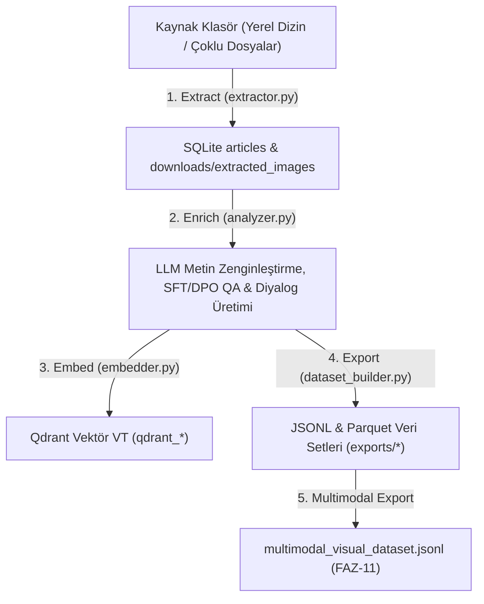

# Folder Mode (Özyinelemeli Klasör İşleme Motoru)

Bu doküman, projemizin **Folder Mode (`input_mode: "folder"`)** özyinelemeli dosya tarama ve sentetik veri seti üretim hattının mimarisini, yaşam döngüsünü ve veritabanı ilişkilerini açıklamaktadır.

---

### 🔄 Folder Mode İşlenme Yaşam Döngüsü

---

### 📅 Ne Zaman ve Hangi Aşamada İşleniyor?

#### 1. Özyinelemeli Çıkarma, Sayfa Düzeni ve Bütünlüklü Şema Kırpma Evresi (`python run.py extract`)
- `input_mode: "folder"` modunda [`pipeline/extractor.py`](../../pipeline/extractor.py) altındaki `ArchiveExtractor` belirlenen hedef klasörü özyinelemeli (recursive) olarak tarar.
- Desteklenen tüm dökümanlar (PDF, TXT, MD, EPUB vb.) çok sütunlu okuma sırası (`column gutter partitioning`), üst/alt bilgi filtreleme ve `page.find_tables()` tabanlı Markdown tablo çıkarımı ile ayrıştırılarak SQLite [`articles`](../../pipeline/extractor.py) tablosuna aktarılır.
- Dökümanlar içindeki şema, grafik ve çizimler [`pipeline/layout_analyzer.py`](../../pipeline/layout_analyzer.py) tarafından negatif tablo maskelemesi (`table_masks`), `internal_drawings >= 20` kontrolü ve IoU tekilleştirme ile parçalanmadan `downloads/extracted_images/` dizinine kaydedilir.

#### 2. Metin & Görsel Zenginleştirme Evresi (`python run.py enrich`)
- [`pipeline/analyzer.py`](../../pipeline/analyzer.py) içindeki `ArchiveAnalyzer` veritabanındaki her bir makaleyi/metni işler.
- LLM (`model_analyzer` / `model_translator`) ve tablo-duyarlı anti-loop filtreli DeepSeek-OCR vizyon modelleri aracılığıyla:
  - Çift Dilli (Bilingual) Metin Zenginleştirme
  - Pragmatik SFT (Supervised Fine-Tuning) Soru-Cevap Çiftleri (`"input": ""` sızıntısız Alpaca şeması ve `clean_boilerplate` telif filtresi)
  - DPO (Direct Preference Optimization) Doğrulama İkilileri
  - Çok Turlu (Multi-turn) Diyalog Dizileri üretilir.

#### 3. Vektörleştirme, İhraç ve Hermes Agent / MCP Erişimi (`python run.py embed` & `python run.py export`)
- İşlenen metinler kelime sınırlarını koruyan parçalarla `nomic-embed-text` modeliyle vektörleştirilerek Qdrant veritabanına yüklenir.
- Sonuçlar `exports/<project_id>/` altında `sft_dataset.jsonl`, `tr_sft_dataset.jsonl`, `dpo_dataset.jsonl`, `chat_dataset.jsonl` ve `multimodal_visual_dataset.jsonl` biçiminde ihraç edilir ve [`hermes-agent/`](../../hermes-agent/README.md) içindeki Hermes yetenekleri (`elektor-dataset-pipeline`, `elektor-ocr-layout`, `elektor-rag-memory`, `elektor-dataset-curation`) ile Stdio MCP sunucusu üzerinden ajan kullanımına sunulur.

---

### 📊 Klasör Modu Projelerinizin İşlenme Durumu

Veritabanları ve ihraç klasörleri incelendiğinde örnek Klasör Modu projelerinin durumu şu şekildedir:

| Proje | Kaynak Veri / Hedef Klasör | SQLite `articles` Sayısı | Zenginleştirilmiş QA Sayısı | Durum |
| :--- | :--- | :--- | :--- | :--- |
| **`rapberry_pi_pico_all`** | Raspberry Pi Pico Kod & Dokümantasyon Klasörü | **843 Makale** | **843 Zenginleştirme** | İşlendi & İhraç Edildi ✅ |
| **`octave`** | Octave Sayısal Analiz Kod Deposu | **382 Makale** | **382 Zenginleştirme** | İşlendi & İhraç Edildi ✅ |
| **`türk`** | Türk Tarih Seti Doküman Klasörü | **414 Makale** | **414 Zenginleştirme** | İşlendi & İhraç Edildi ✅ |

**Özetle:** Klasör modu, hiyerarşik veya karışık dosya yapılarını özyinelemeli tarayarak yüksek kalitede sentetik veri seti oluşturmak üzere tam entegre biçimde çalışmaktadır.
